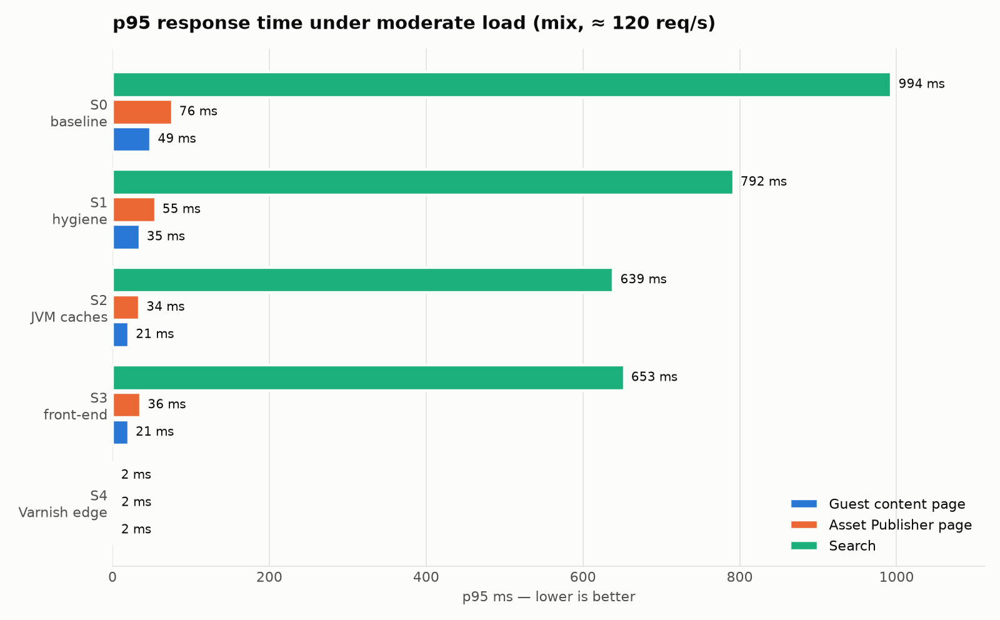
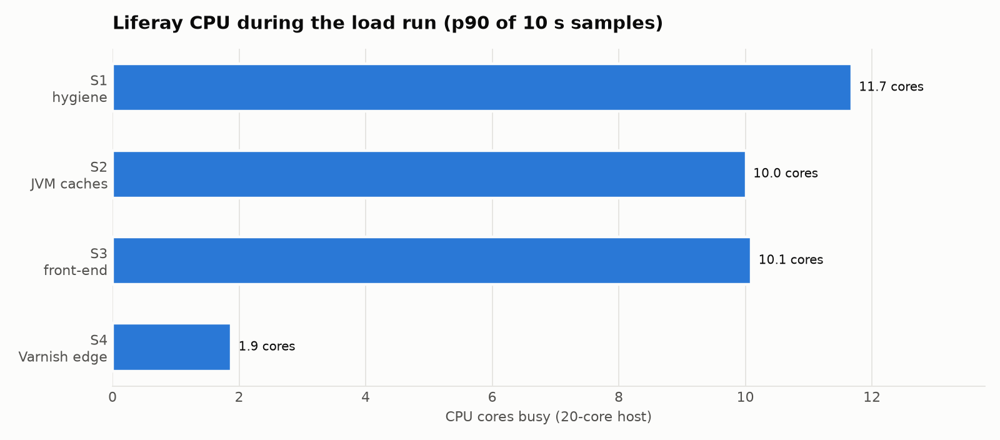
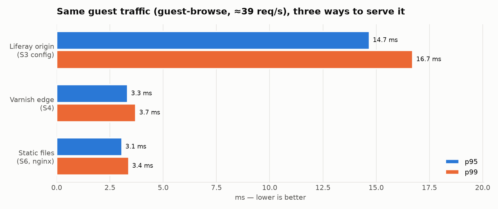

# Lab results: the S0…S6 ladder on a real Liferay (2026-10-24)

These are **measured** numbers. The `*-mock` folders next to this file only prove that
the scripts work. Every other folder in `results/` comes from the runs described here,
against a real Liferay serving the Part 0 base site.

For how far each configuration goes before it breaks, see **[STRESS-RESULTS.md](STRESS-RESULTS.md)**.
The "load" pass below is a fixed, moderate load (about 120 req/s, under 10 requests in
flight), not a capacity test.



## Setup

| | |
|---|---|
| Portal | Liferay DXP **2026.q1.12-lts**, official Docker image (`liferay26112`), JDK 21 (Zulu), Tomcat 10.1 |
| Data | **Hypersonic** (embedded) + **sidecar Elasticsearch 8.19** — the image defaults. Not production-grade (see caveats) |
| Host | 20 cores, 64 GB RAM, Linux; k6, Varnish and nginx run on the same host |
| Site | `part0-base-site`: 10 fragment content pages, an Asset Publisher News page (10 web content articles), a Blogs page (14 posts), a search page, D&M (8 JPEGs + a 210 KB PDF). `/web/proventeq` |
| Edge (S4/S5) | Varnish 7.6, `matrix/varnish/default.vcl` (with the login fix below), on `:6081` |
| Static (S6) | `part2-static-prototype` output (29 pages, 1.15 MB, 7.3 s fetch + build), nginx 1.27 on `:8090` |
| Load tool | k6 v2.3.0 |

## Method

* Each stage builds on the one before it. `matrix/local/apply-stage.sh S1|S2|S3` writes the
  stage's `portal-ext.properties` / `setenv.sh` / `server.xml` / OSGi config into the
  container and restarts Liferay.
* Each stage has two measured passes (`run-stage.sh`):
  1. **Standard:** every scenario, open model, `RATE=10`, 60 s (`results/<stage>/`).
  2. **Load:** `mix` for 90 s, with container CPU sampled every 10 s (`results/<stage>-load/`).
     The target was a peak of 80 journeys/s (`RATE=80`), but the VU cap (`VUS=20`, i.e. ≈ 360
     VUs across the four scenarios) was reached and k6 dropped ≈ 12 journeys/s. What actually
     ran was ≈ 38 journeys/s averaged over the ramp, **115–120 req/s**, with 1–9 requests in
     flight at the origin (rate × mean latency). The shape was identical at every stage, so the
     stage-to-stage comparison holds; the absolute load is light.
* Each pass starts with an unrecorded 30 s warm-up.
* **Configuration that was applied** (only what makes sense on one node with Hypersonic):

  | Stage | Applied |
  |---|---|
  | S1 | All S1 properties; 4 GB heap, G1, GC log |
  | S2 | Ehcache 3 override XML, HikariCP / Hibernate properties, the S2 Tomcat connector, a 6 GB pre-touched G1 heap, and **all 16 site fragments marked Cacheable** (JSONWS `fragment.fragmententry/update-fragment-entry`; a database flag, which `apply-stage.sh` now sets for S2+ and clears for S0/S1) |
  | S3 | `browser.cache.disabled=false` + `browser.cache.signed.in.disabled=true`, ETag/Header filters, and D&M Cache Control `public, max-age=86400` |
  | S4 | Varnish in front of the S3 origin |

* **Configuration that was skipped:**

  | Stage | Skipped | Why |
  |---|---|---|
  | S2 | Cluster Link / JDBC_PING | Single node, no MySQL |
  | S3 | `cdn.host.*` | No CDN in the lab |
  | S4 | `web.server.protocol=https` | Plain HTTP edge |

* `headless-api` signs in once and reuses the session (`API_AUTH=session`); see the findings below.

## Standard pass: p95 ms at RATE=10 (the box is nearly idle)

| scenario | S0 baseline | S1 hygiene | S2 JVM caches | S3 front-end | S4 Varnish | S6 static |
|---|---:|---:|---:|---:|---:|---:|
| guest-browse (4 pages/visit) | 19 | 19 | 17 | 17 | **3** (100 % hit) | **3** |
| content page | 14 | 15 | **9** | 9 | 3 | 4 |
| Asset Publisher page | 30 | 31 | 30 | 29 | **3** | 4 |
| search `?q=` | 392 | 360 | 353 | 371 | **3** | 2 (static shell) |
| dl-download (210 KB PDF) | 4 | 4 | 5 | 5 | 2 | – |
| headless by-id (DB / entity cache) | 8 | 8 | 8 | 8 | 8 (bypass) | – |
| headless list (Elasticsearch) | 25 | 27 | 26 | 26 | 24 (bypass) | – |
| login journey | 742 | 757 | 752 | 708 | 668 (bypass) | – |
| mix (all) | 173 | 205 | 208 | 158 | **5** (95 % hit) | – |

There were 0 errors in every row. Guest HTML carried `Set-Cookie` and
`Cache-Control: private, no-store` in 100 % of S0–S2 responses. In S3 it was 0 % `private`,
and in S4 it was 0 % for both.

## Load pass: p95 ms, mix at about 120 req/s

| scenario | S0 | S1 | S2 | S3 | S4 |
|---|---:|---:|---:|---:|---:|
| guest pages (`mix/guest_browse`: four pages in one journey) | 49 | 35 | 21 | 21 | **2** |
| Asset Publisher page | 76 | 55 | 34 | 36 | **2** |
| search | 994 | 792 | 639 | 653 | **2** |
| login (must not be cached) | 1106 | 992 | 890 | 921 | 537 |
| mix (all) | 521 | 423 | 379 | 422 | **6** |
| Liferay CPU, p90 of samples | ≈ 9.1 cores (one sample) | 11.7 | 10.0 | 10.1 | **1.9** |



Across the whole S4 campaign, not this pass alone, Varnish counted 18,656 hits and 16 misses. The 4,902 passes are login, the APIs
and `/c/` URLs. Login through the edge stays at 0 % edge hit, and its signed-in page
stays `private, no-cache, no-store`. Login gets *faster* at S4 only because the origin
has spare CPU.

## Same guest traffic, three ways to serve it

`guest-browse` was requested at 80 journeys per second (`RATE=80`, `VUS=20`). The executor's
VU cap (80) held the actual load at **≈ 9.4 journeys/s, about 39 req/s**, the same for all three
targets; k6 dropped the other ≈ 66 journeys/s. The comparison is fair, the load is light —
the capacity ladders in [STRESS-RESULTS.md](STRESS-RESULTS.md) push the same three targets to
their limits.

| target | req/s | p50 | p95 | p99 |
|---|---:|---:|---:|---:|
| Liferay origin (S3 config) | 38.8 | 7.3 | 14.7 | 16.7 |
| Varnish edge (S4) | 39.2 | 2.5 | 3.3 | 3.7 |
| Static files on nginx (S6) | 38.5 | 2.3 | 3.1 | 3.4 |



## S5: publish → fresh at the edge

A News article title is PATCHed through Headless Delivery while k6 polls `/web/proventeq/news`
on the origin and on the edge every 250 ms (`matrix/local/s5-publish.sh ttl|purge`).

| variant | origin_to_edge_ms |
|---|---:|
| no purge (TTL 60 s) | **55,655** (1 run) |
| BAN of the polled page's URL right after the publish | **17 / 18 / 19** (3 runs; the poll interval of 250 ms is the resolution) |

The S5 Java listener (`S5-edge-purge/src`) is a sketch that needs a Liferay workspace
build. The purge variant therefore sends a BAN by script, matching the polled page's URL
(`X-Ban-Url`), not the tag ban the listener sketch would send. It measures the edge
mechanics, not the module, and it doesn't test tags.

## Findings

1. **The edge is the lever, and nothing before it comes close.** Under load:
   * S0→S3 improved guest p95 from 49 to 21 ms, a **2.3× gain**;
   * S3→S4 improved it from 21 to 2 ms, a further **10×**;
   * S4 cut origin CPU by about 80 %.

   The talk's ordering (hygiene and JVM caches are small, the edge is big) holds on real Liferay.
2. **The Asset Publisher costs 2.1× a content page at S0 (30 vs 14 ms), close to Liferay's published 2.3×.**
   * Fragment *Cacheable* (S2) speeds up content pages (14→9 ms) and leaves the AP page
     alone, so the gap *widens* to 3.3×.
   * At the edge both pages cost the same (3 ms).
3. **S1 is noise when the box is idle and modest under load.**
   * At RATE=10, S1 changed nothing measurable.
   * Under load it gave −29 % guest p95, but that also includes the restart (S0 ran on a
     JVM that had been through a dozen site deployments) and the 2.5→4 GB heap.
   * S2's gain under load (35→21 ms) is the larger and more trustworthy step: content
     pages also improve at idle (14→9 ms).
4. **S3 changes headers, not milliseconds.** TTFB stayed flat. Its value is that S4 can
   cache at all: guest HTML lost `no-store`, and the brochure PDF went to `public, max-age=86400`.
5. **Search is the slowest guest page (about 350–390 ms at idle, about 1 s under load).**
   * At the edge it becomes 3 ms because the VCL caches `?q=` results by normalised query string.
   * Our VCL only strips tracking parameters (a deny-list) and sorts the rest, so unique queries can fill the cache. Consider an allow-list, or a cap on `?q=` objects.
6. **Without a purge, freshness is the TTL; with a purge it is immediate.** 55.7 s versus
   under 20 ms is the S5 slide.

## Things the real runs exposed and fixed in this repo

* **VCL login bug (S4):** `/c/portal/login` redirects to `<page>?p_p_id=…LoginPortlet…`
  (lifecycle 0). The VCL cached that page and stripped `Set-Cookie`, so every login POST
  through the edge failed with **403**: the CSRF token was bound to a session the browser
  never got.
  * Fixed in `default.vcl` and `default-xkey.vcl` by never caching `p_p_id=com_liferay_login_web_portlet_*`.
  * The same rule applies to any guest page with a session-bound form.
* **Varnish compose:** the `tmpfs` for `/var/lib/varnish` was root-owned and the image runs as
  `varnish`, so `varnishd` refused to start. Fixed with `mode=1777`.
  `docker-compose.local.yml` puts Varnish on the default bridge next to a `docker run` Liferay.
* **D&M Cache Control config (S3):** the PID and keys in the repo were wrong.
  * Correct PID: `com.liferay.document.library.web.internal.configuration.CacheControlConfiguration`.
  * Correct keys: `cacheControl`, `maxAge`, `notCacheableMimeTypes`.
  * Verified on 2026.Q1; the header flipped to `public, max-age=86400`.
* **`login.js`:** from S3 on, the login POST's 302 carries no `Cache-Control`, so the old
  "must be private" check failed and skipped the signed-in page.
  * The POST is now checked for "not publicly cacheable".
  * The **signed-in page** is checked for `private`. It is `private, no-cache, no-store` at every stage.
* **Signed-in marker:** a custom header has no `/c/portal/logout` link. `isSignedIn: () => true`
  (ThemeDisplay JS) works with any theme.
* **`headless-api.js`:**
  * Guests get `403 { }` from `/o/headless-delivery`, because no default Service Access Policy opens it.
  * HTTP Basic re-verifies the password hash on *every* call (about 500 ms for by-id *and* list),
    which hides the DB-versus-index difference.
  * New `API_AUTH=session` mode: sign in once and send the session cookie plus `x-csrf-token`.
    By-id is 8 ms and list is 25 ms.
* **k6 and `localhost`:** k6's Go resolver sent `localhost` to the network DNS server here.
  Use `127.0.0.1`.

## Caveats

* **Hypersonic and sidecar Elasticsearch** are the image defaults, and Liferay says not to use
  them in production.
  * DB-bound numbers (headless by-id, entity-cache effects in S2) look better than they would on
    MySQL or PostgreSQL over a network.
  * Search latency comes from a sidecar on the same box.
* **One host** runs Liferay, Elasticsearch, Varnish, nginx and k6, so edge numbers include no
  network RTT. On a real CDN, add the client's RTT; the *origin* savings do not change.
* **One run per stage** (S5 TTL: one run; S5 purge: three runs). Differences of a few ms at
  RATE=10 are inside the noise.
* **S0 load CPU** is a single mid-run sample; per-10 s sampling was added from S1 on.
* **S6 is static output of 10 fragment pages, rendered as admin.** Theme and fragment CSS/JS are
  stripped, search is a Pagefind shell, and images and the PDF still come from Liferay.
  It is valid for latency, not for fidelity.

## Reproduce

```bash
# base site (writes part0-base-site/dist/k6.env)
cd part0-base-site && bun build.ts --deploy && cd ../part1-simulations

./run-stage.sh S0-baseline
matrix/local/apply-stage.sh S1 && ./run-stage.sh S1-hygiene
matrix/local/apply-stage.sh S2 && ./run-stage.sh S2-jvm-caches   # also marks the fragments Cacheable
matrix/local/apply-stage.sh S3 && ./run-stage.sh S3-frontend
(cd matrix/varnish && LIFERAY_UPSTREAM=$(docker inspect -f '{{range .NetworkSettings.Networks}}{{.IPAddress}}{{end}}' liferay26112) \
  docker compose -f docker-compose.yml -f docker-compose.local.yml up -d)
BASE_URL=http://127.0.0.1:6081 ./run-stage.sh S4-edge-varnish
matrix/local/s5-publish.sh ttl; matrix/local/s5-publish.sh purge
(cd ../part2-static-prototype && ENV_FILE=.env.local-proventeq node pipeline/regenerate.mjs --full --no-ai)
(cd matrix/S6-static/local && docker compose up -d)
BASE_URL=http://127.0.0.1:8090 ./campaign.sh S6-static guest-browse guest-browse-sticky asset-publisher search
python3 summarize.py && python3 compare.py && python3 lab_charts.py   # charts need matplotlib
```

`matrix/local/apply-stage.sh S0` restores the container's original `setenv.sh` and
`server.xml`, an empty `portal-ext.properties`, and clears the fragments' Cacheable flag.
