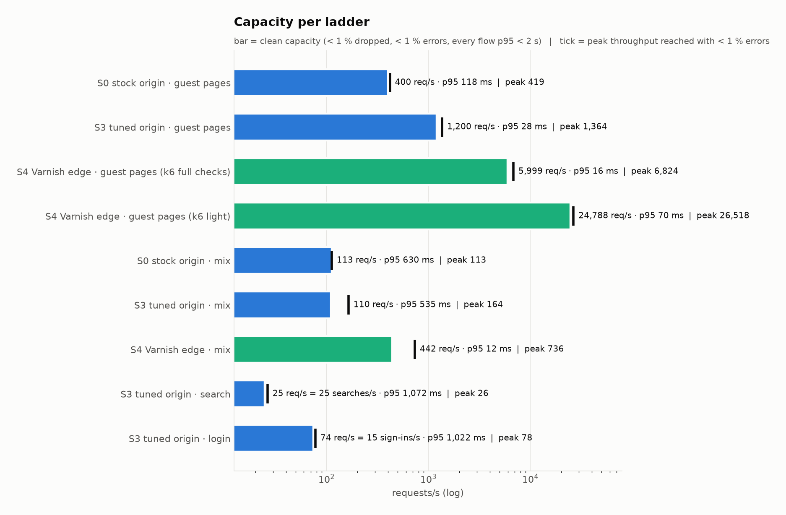
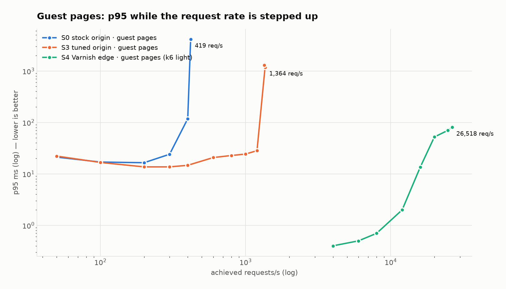
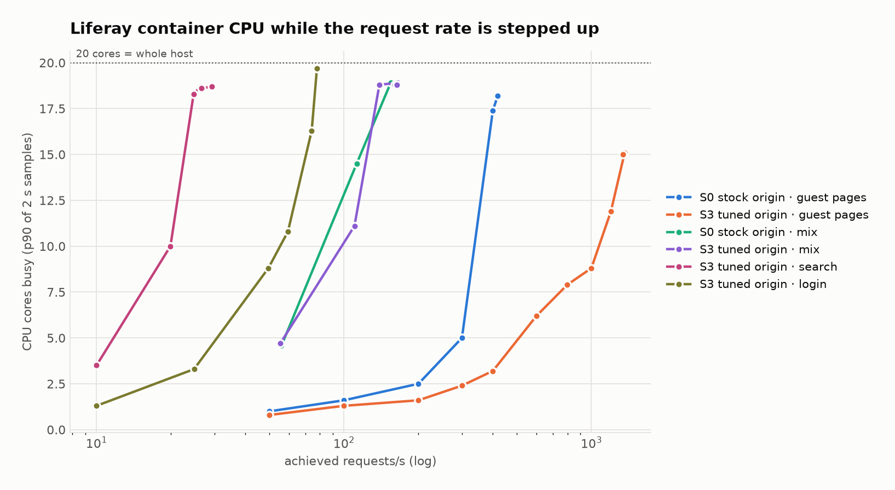
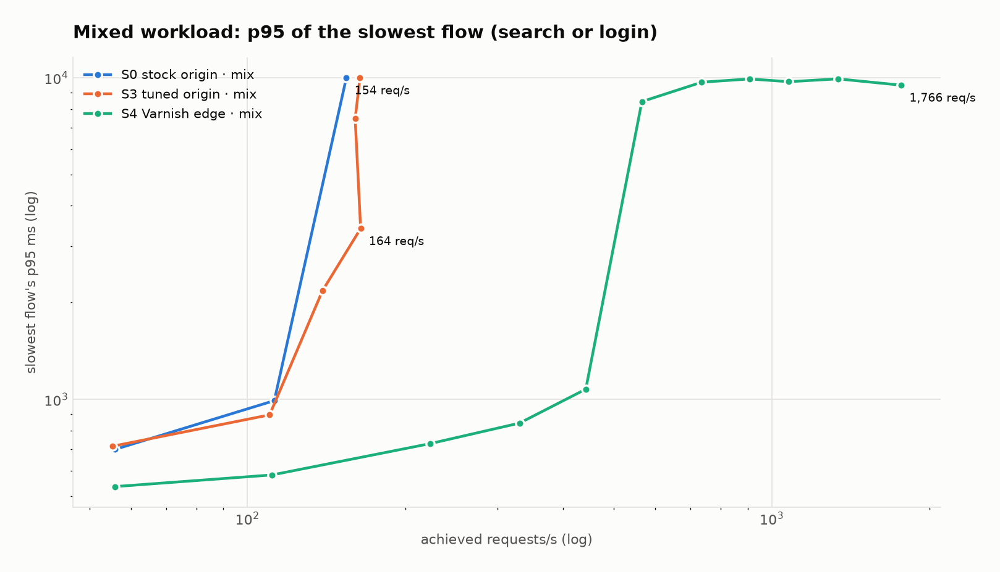

# Stress results: how far each configuration goes before it breaks (2026-10-24)

These are capacity tests. The request rate goes up in steps until the target saturates. The
fixed-load S0…S6 comparison is in [LAB-RESULTS.md](LAB-RESULTS.md). That run's "load pass"
was light (≈ 120 req/s, under 10 requests in flight). This one pushes every configuration
past its limit. The same site, container and host are used, and the
[setup table](LAB-RESULTS.md#setup) applies. The static site against the same Varnish edge,
for HTML and for whole page views, is in [STATIC-VS-EDGE.md](STATIC-VS-EDGE.md).



## Headline numbers

The numbers are given per *ladder*: one configuration × one workload. **Clean capacity** is the
last step with < 1 % of iterations dropped, < 1 % errors, and every flow's p95 under 2 s.
**Peak** is the highest throughput reached with < 1 % errors.

| ladder | clean capacity | p95 there | peak | what ran out |
|---|---:|---:|---:|---|
| S0 stock origin · guest pages | **400 req/s** | 118 ms | 419 req/s | CPU: at the saturated 600/s step, 69 % of busy request threads were **re-parsing fragment FreeMarker templates**. The 2.5 GB heap filled up (2.53 GB old gen, 9 full GCs) |
| S3 tuned origin · guest pages | **1,200 req/s** | 28 ms | 1,364 req/s | Host CPU: Liferay 15 cores + k6 4 cores of 20 |
| S4 Varnish edge · guest pages | **24,800 req/s** | 70 ms | 26,500 req/s | Host CPU (k6 14 cores, Varnish only **2.8**). Our 2,000-thread limit on Varnish was also hit; the 2026-11-01 rerun with 5,000 threads reached the same 24,800 |
| S3 tuned origin · search | **25 searches/s** | 1.1 s | 26 /s | The Elasticsearch sidecar: ≈ 90 % of search CPU |
| S3 tuned origin · sign-in | **15 sign-ins/s** (74 req/s) | 1.0 s | 17 /s | **PBKDF2 password hashing**: 100 % of busy request threads |
| S0 stock origin · mix | 100 it/s (113 req/s) | 0.6 s | 113 req/s | search + sign-in |
| S3 tuned origin · mix | 100 it/s (110 req/s) | 0.5 s | 164 req/s | search + sign-in |
| S4 Varnish edge · mix | **400 it/s** (442 req/s) | 12 ms (sign-in 1.1 s) | 736 req/s | sign-in: the only flow the edge cannot absorb |

`mix` = 85 % guest pages, 12 % search, 3 % sign-in (form → POST → signed-in page → logout).
Guest pages = home 25 %, four content pages 45 %, blog 15 %, News (Asset Publisher) 15 %. All
requests are cookie-less fresh visitors.

## What each step costs

The Liferay container's CPU at a clean step, divided by the rate. The container includes the
Elasticsearch sidecar.

| unit of work | CPU per unit | relative |
|---|---:|---:|
| guest page view, S3 tuned (fragments Cacheable) | ≈ 8–10 ms | 1× |
| guest page view, S0 stock | ≈ 12–17 ms at 200–300/s, **43 ms at 400/s** (non-linear) | 1.5–5× |
| search page (`?q=`) | ≈ 350–500 ms at 10–20/s (≈ 90 % of it in Elasticsearch) | ≈ 50× |
| sign-in (4 requests) | ≈ 650 ms at 2–5/s, ≈ 1.1 s at 15/s | ≈ 80–120× |
| guest page view from Varnish | ≈ 0.1 ms (2.76 Varnish cores at 26,500 req/s, 615 MB/s) | ≈ 1/80 |

**A sign-in costs about as much as 100 guest page views, and a search about 50.** This is
why the three mixed ladders end where they do. At 100 it/s, the 12 searches/s and 3
sign-ins/s alone need ≈ 6–8 cores, whatever the page tuning.

## Findings

### 1. The edge multiplies guest capacity by 20× over the tuned origin and 60× over the stock one

* **Clean guest-page capacity:**

  | configuration | clean capacity |
  |---|---:|
  | S0 stock origin | 400 req/s |
  | S3 tuned origin | 1,200 req/s |
  | S4 Varnish | 24,800 req/s |

* **The limit at 24,800 is the lab, not Varnish.** Varnish used 2.8 cores at 26,500 req/s.
  The limits were:
  * k6 on the same 20-core host (14 cores);
  * the `thread_pool_max` we had set: 2 pools × 1,000 threads, one per connection (Varnish's own default is 5,000 per pool). k6
    held up to 3,000 connections. By the end of the ladder Varnish had turned away 103,714
    connections for lack of a thread (`MAIN.sess_dropped`, counted since Varnish started), and
    hit the thread cap 26,288 times (`MAIN.threads_limited`).
* **On the way to 24,800 req/s Liferay used 0.2 cores and created no sessions.**
* **Light mode was needed to measure this.** With body checks on, k6 itself saturated at
  ≈ 6,800 req/s (17.7 cores for k6, 0.8 for Varnish). That ladder is kept as
  `S4-edge-pages` and shows why the load generator must be measured too. The edge ladder
  therefore ran with `LIGHT=1`: status and `Content-Length` checks only, and the body is
  never handed to JS.



### 2. On the origin, fragment "Cacheable" (S2) is the step that triples capacity

* **S0 → S3: 400 → 1,200 req/s clean, at roughly half the CPU per page.**
* **The S0 profile (600/s, `S0-origin-pages/threads-600-summary.txt`):** four
  `jcmd Thread.print` samples gave 261 of 300 request-thread samples RUNNABLE.
  **69 % were in `FMParserTokenManager` under `FreeMarkerFragmentEntryProcessor`**, i.e. every
  render re-parses each fragment's FreeMarker template.
* **The S3 profile (fragments Cacheable, same 600/s, `S3-origin-pages/threads-600-summary.txt`):**
  17 of 200 samples RUNNABLE, and **0 %** parsing.
* **S0's cost is non-linear.** CPU was 5 cores at 300/s and 17.4 cores at 400/s, and it
  climbed *within* the 400/s step from 9 to 17 cores. GC was not the cause: 1.5 s of young GC
  in total by the end of that step, and no full GC until the 600/s step.
* **The Cacheable flag lives in the database, not in a config file.** The first S0 stress run
  here was invalid: the flag set during the S2 lab run was still on. That run is kept as
  `stress/_invalid-S0-cacheable-on/` and excluded from the report. `apply-stage.sh` now sets
  the flag for S2+ and clears it for S0/S1, and prints the result.



### 3. Sign-in capacity is the password hash, by design

* **Liferay's default is `passwords.encryption.algorithm=PBKDF2WithHmacSHA1/160/1300000`.**
* **At 12 sign-ins/s, 100 % of busy request threads were in BouncyCastle's SHA-1 digest**
  (`S3-origin-login/threads-12-summary.txt`).
* **The rule of thumb is sign-ins/s ≈ cores ÷ 0.7 s**, which gives 15–17/s on this 20-core host.
  * Tuning the portal does not move this.
  * Offloading authentication to an IdP or SSO does.
  * Sizing login storms (9 a.m. Monday) separately does.
  * Lowering the iteration count is a security decision, not a performance tweak.
* **The flow saturates without errors.** At 20/s it reached 17.4/s, 13 % dropped, p95 5.9 s.
  Threads queue, then time out.

### 4. Search is Elasticsearch-bound, and the sidecar is expensive

* **At 20 searches/s:** the Elasticsearch JVM used 7.6 cores and the Liferay JVM 0.7. Every
  busy Liferay request thread was waiting on Elasticsearch.
* **Per search page:** 3 shard queries. The hot Elasticsearch frames are highlighting
  (`DefaultHighlighter` / unified highlighter) and `BooleanQuery.rewrite`.
* **On a 323-document, 2.4 MB index:** even one `q=azure` query takes 32 ms on the sidecar.
* **When it fails, it fails hard.** At 25/s it is clean (p95 1.1 s). At 35/s 12 % of searches
  are dropped, 5 % fail and p95 hits the 10 s timeout.
* **What to do:**
  * run a real Elasticsearch cluster (the sidecar is not for production);
  * switch off highlighting where the results template does not show it (measured 2026-11-01:
    25 → 300 searches/s clean, p95 at 20/s 687 → 38 ms, same results; see `RUNG-RESULTS.md`);
  * keep caching popular `?q=` pages at the edge, as S4 does.

### 5. Plan capacity per flow: the overall p95 hides the flow that fails

* **The S4 edge mix:** every cached flow (pages *and* `?q=` search) stayed at p95 ≤ 11 ms up to
  1,500 it/s. **Sign-in collapsed from 600 it/s**, i.e. 18 sign-ins/s, just above the ceiling in
  finding 3:
  * p95 8.4–9.9 s;
  * only 32 % of sign-ins succeeded at 1,500 it/s and 22 % at 2,000.
* **The overall p95 fell back to 23–44 ms at 1,500–2,000 it/s** while sign-in was failing. Once
  sign-ins are under 5 % of requests, they drop out of the overall percentile.
* **The capacity rule here therefore checks every flow's p95,** and `STEPS.md` has a per-flow
  table for every ladder.
* **Recommendation:** set an SLO per flow, not per site.



### 6. Guest sessions grow the heap with traffic

* **Every cookie-less request to the origin gets a new `JSESSIONID`** (`Set-Cookie` on 100 % of
  guest page responses from the origin, 0 % from Varnish). The session timeout is 15 min.
* **On the S3 pages ladder** the old gen grew from 0.7 GB to 2.1 GB over its ≈ 14 minutes.
* **S0's stock 2.5 GB heap** reached 2.53 GB old gen with 9 full GCs at its last step.
* **Through Varnish** no guest request reached Liferay, so no sessions were created.
* **Without an edge,** size the heap for `req/s × session timeout` sessions, or stop sessions
  being created for anonymous page views.

### 7. Tuning does nothing for the mixed workload's ceiling; the edge does

* **S0 and S3 both run the mix cleanly at 100 it/s, and both are saturated at 200 it/s.** S3,
  refined, already misses the bar at 125 (search p95 2.2 s). Search and sign-in take most of
  the CPU, and S1–S3 do not touch either.
* **The S4 edge takes the mix to 400 it/s cleanly (4×),** because it absorbs pages and
  repeated searches. Sign-in sets the new ceiling.

## Method

* **The k6 script:** `k6/stress.js`, one step per run.
  * Open model (`constant-arrival-rate`), 60 s per step, no think time, 10 s request timeout.
  * `MAX_VUS` 1,500 (3,000 for the edge pages ladders).
  * When the target slows, k6 adds VUs up to the cap and then drops iterations.
* **The ladder driver:** `stress.sh <label> <workload> <rates…>`.
  * `stress_sampler.py` samples every 2 s: host CPU, each container's CPU and memory from its
    cgroup, k6's CPU, and the Liferay heap (`jstat`).
  * A ladder stops after the first saturated step: errors > 5 %, dropped > 10 %, or overall
    p95 > 5 s.
  * The stricter per-flow capacity rule above is applied afterwards by `stress_report.py`.
* **The campaign:** `stress-campaign.sh`.
  * Before every origin ladder Liferay is restarted and warmed up for 60 s at 20 it/s.
  * `R` adds refinement steps between the last clean and the first saturated step (search 25/30/35,
    sign-in 12/15, mix 125/150/175), each set on its own fresh restart.
  * `L` is the light edge ladder.
  * S0 is applied with `apply-stage.sh S0` (stock `setenv.sh`, `server.xml`, empty
    `portal-ext.properties`, fragments not Cacheable). S3 is re-applied at the end.
* **The profiles:** `jcmd Thread.print` ×4 (Liferay) and `_nodes/hot_threads` (Elasticsearch) were
  taken during separate probe steps at the same rates. They are summarised in
  `stress/*/threads-*-summary.txt`; the raw dumps are gzipped next to the summaries.
* **Every step** is in [stress/STEPS.md](stress/STEPS.md) (steps, CPU, heap, and a per-flow p95
  table) and in `stress/<ladder>/steps.csv`. The raw k6 summaries and samples are in the same folders.

## Caveats

* **k6 runs on the same 20-core host.**
  * Origin ladders: k6 took 1–4 cores. The S3 pages limit (≈ 1,370 req/s) is therefore a host
    limit with Liferay at ≈ 15 cores, not a pure Liferay limit.
  * Edge ladders: k6 is the main CPU user. 24,800 req/s is a lower bound for Varnish on this box.
* **Hypersonic and the Elasticsearch sidecar,** as in the lab run. Search numbers are sidecar
  numbers. DB-bound work is optimistic.
* **Each step runs once, for 60 s.** One step was repeated on a separate run and agreed:
  sign-in at 12/s gave 878 vs 828 ms p95 (10.8 vs 10.2 cores). Treat differences of under
  ~10 % as noise.
* **No network, TLS or CDN.** Edge latencies have no RTT. Throughput per Varnish core is
  plain-HTTP loopback.
* **Edge search caching flatters the edge mix.** There are only 8 search terms, so every `?q=`
  is an edge hit after the first. Real long-tail queries would pass to the origin.
* **0.17 % of light-mode responses failed the size check without being HTTP errors.** These were
  responses with no usable `Content-Length` (`html_bytes` min 0); they are not counted as errors.

## Reproduce

```bash
cd part1-simulations
matrix/local/apply-stage.sh S3                  # tuned origin, fragments Cacheable
./stress-campaign.sh S3 S4 S0 R L               # ≈ 2 h; results/stress/<ladder>/
python3 stress_report.py                        # STEPS.md + the four stress-*.png (needs matplotlib)
```
