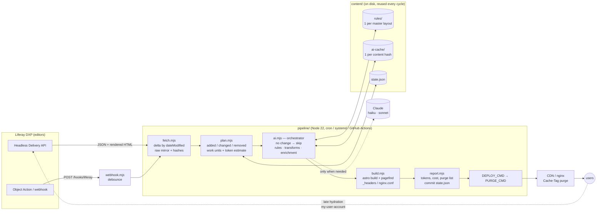

# Part 2 — Liferay as the editor, plain HTML as the site

Prototype for *"Making Liferay Blazing Fast in Production"*, DevCon 2026.
Editors keep working in Liferay. The public site is **static HTML generated from
Headless Delivery**, regenerated periodically by a pipeline in which an AI agent is
"in charge" of the judgement calls but is designed to cost almost nothing:
deterministic scripts do the bulk work, the model is consulted only for decisions
that need judgement, and its answers are cached so later cycles are free.

Verified end-to-end against the public `liferay.dev` site (anonymous, no key needed).

> **Same look as the portal:** [`fidelity/`](fidelity/README.md) is a second generator. It renders
> the site from Headless Delivery's page definitions, the fragment templates and the theme CSS,
> so the static pages match Liferay's pixel for pixel (`node fidelity/build.mjs`, or
> `node fidelity/regenerate.mjs` to rebuild only on change and list the pages to purge). The pipeline
> below instead takes rendered page bodies and puts them into its own Astro layout.

## Architecture



**Flow of one cycle** (`node pipeline/regenerate.mjs`):

1. `fetch.mjs` pulls blog postings, documents, structured contents (delta:
   `filter=dateModified gt <lastRun>`), site pages (+ rendered HTML only when
   `dateModified` moved) and navigation menus into `content/raw/`. Every N runs it
   re-lists ids (`fields=id`) to catch deletions.
2. `plan.mjs` hashes *only the fields that matter* per item (a comment counter
   ticking up is not a change) and diffs against `content/state.json` →
   `content/plan.json` with the work units that *might* need the model and a token estimate.
3. `ai.mjs` reads the plan. Nothing changed → **exit, no build, no tokens**.
   Otherwise: resolve extraction rules, run deterministic transforms, enrich
   changed items that miss fields, write `content/build/*.json` for Astro.
4. `build.mjs` runs `astro build` + Pagefind, emits `_headers` and `nginx.conf`
   with `Cache-Control` and a `Cache-Tag`/`Surrogate-Key` per page.
5. `report.mjs` writes `reports/<ISO>.md` + `latest.json` (changes, pages, build
   time, dist size, tokens cached vs fresh, cost, broken links, purge list) and
   only then commits `state.json` — a failed cycle retries the same diff.
6. Optional `DEPLOY_CMD` and `PURGE_CMD` (receive `PURGE_URLS`, `PURGE_TAGS`, `PURGE_ALL`).

## Why the model is "in charge" and still cheap

| Mechanism | Where | Effect |
|---|---|---|
| **No-change fast path** | `ai.mjs` | 174 unchanged items → 0 tokens, 0 s of Astro, ~1 s total |
| **Delta detection** | `fetch.mjs`, `plan.mjs` | only `dateModified > lastRun` is downloaded; content hash decides what is *really* changed |
| **Rule caching** | `content/rules/<master>.json` | the *smart* model is asked once per master layout / content structure for CSS selectors; applied by string code forever after |
| **Content-hash AI cache** | `content/ai-cache/<sha256>.json` | a summary is paid for once per version of a post; unchanged posts never hit the API again |
| **Only missing fields** | `plan.mjs` `missingFields()` | posts with an editor-written description never go to the model at all |
| **Hard budget** | `AI_BUDGET_TOKENS` (20 000) | the orchestrator stops asking and uses fallbacks; the report says so |
| **Prompt caching** | `ai-client.mjs` | byte-stable system prompt with `cache_control: {type:"ephemeral"}`; usage logs `cache_read_input_tokens` |
| **Batching** | `AI_BATCH_SIZE` (8) | one call summarises 8 posts |
| **Cheap vs smart** | `AI_MODEL_CHEAP` / `AI_MODEL_SMART` | Haiku for per-item text, Sonnet only for the one-off extraction rule |
| **Deterministic fallback for everything** | `ai.mjs` | first 160 chars as description, `#main-content` as region, regex link rewriting — the site builds with the key unset |

Measured on liferay.dev (80 posts, 80 documents, 7 pages, 8 menus): the whole
catalogue would need **4 calls, ≈14 500 tokens (≈ $0.03)** the first time; every
following cycle is 0 tokens unless a post changes, and then only that post.

Prompt-caching note (verified against the docs on 2026-09-18): no beta header is
needed; the minimum cacheable prompt is 4 096 tokens on Haiku 4.5 and 1 024 on
Sonnet 4.5 — shorter system prompts are silently not cached, so watch the
`cached` column in the report. Confirm current model IDs before the talk.

## Running it

```sh
npm install
cp .env.example .env            # defaults already point at liferay.dev
node pipeline/regenerate.mjs --full --no-ai --max-items 80   # first build, ~15 s
node pipeline/regenerate.mjs                                  # delta: "no changes, build skipped" in ~1 s
node pipeline/regenerate.mjs --dry-run --full --offline       # prints the prompts + token estimate, no key needed
node tools/serve.mjs dist       # http://localhost:4321 with the generated Cache-Control / Cache-Tag headers
node tools/check-links.mjs dist # internal link checker (0 broken expected)
node pipeline/webhook.mjs       # POST /hooks/liferay (x-api-key) → debounced cycle; GET /healthz
```

Flags: `--full` (ignore state) · `--no-ai` · `--dry-run` · `--offline` (use `content/raw` only) ·
`--max-items N` · `--force` (build even with no changes) · `--relist` (deletion sweep now).

Set `ANTHROPIC_API_KEY` in `.env` and the same commands go live; every call is logged
with input / output / cache-read tokens in `reports/latest.json`.

## Pointing it at your own DXP

Edit `.env` — nothing else changes:

```
LIFERAY_URL=https://dxp.example.com
LIFERAY_SITE_ID=20121
LIFERAY_AUTH=oauth2                 # none | basic | oauth2 (client credentials against /o/oauth2/token)
LIFERAY_OAUTH_CLIENT_ID=...         # Control Panel → Security → OAuth 2 Administration, "Client Credentials"
LIFERAY_OAUTH_CLIENT_SECRET=...
SITE_MENU_NAME=Main Navigation      # the navigation menu used for the header
HOME_PAGE_PATH=/home                # which site page becomes "/"
SKIP_PAGES=/search                  # pages that only host dynamic portlets
ASSET_ORIGIN=https://cdn.example.com   # where /documents/... images are served from
PUBLIC_URL=https://www.example.com  # canonical + purge URLs
```

Structured contents (`/structured-contents`) are fetched and rendered generically
(`site/src/pages/content/[slug].astro`, template name `structure-<contentStructureId>`);
add a specific template per structure id when you need one. Master layouts you have
not seen before get their own extraction rule on first sight.

## What breaks compared to the portal — and the mitigation

| Portal feature | Static site | Mitigation in this prototype |
|---|---|---|
| Forms, comments, ratings | no server | "Comment / edit in the portal" link on every post → portal handles it; or embed a form client extension that posts to `/o/` APIs |
| Search relevance (Elasticsearch, facets) | none | Pagefind index built at build time — instant, offline, but lexical only; link "advanced search" to the portal |
| Personalization / segments | one HTML for everyone | late-hydration island (`PortalChrome.astro`): static page first, then `my-user-account` swaps in "Hi name" — needs same origin or CORS + `SameSite=None` cookies |
| Workflow preview, staging | only published content | the fetcher uses the delivery API, so only published, live content ever appears; preview stays in the portal |
| Permissions on content | everything public | fetch runs anonymously (`LIFERAY_AUTH=none`) so it can only see what Guest sees — by construction |
| Freshness | up to one cycle late | 15-min timer + webhook debounce; CDN `stale-while-revalidate` keeps serving during rebuilds |
| Deleted content | could linger | id re-list every `FULL_RELIST_EVERY` runs + nightly `--full`; purge list includes removed paths |
| Dynamic portlets (asset publisher, search pages) | render empty for Guest | flagged as *thin pages* in the report; `SKIP_PAGES` excludes them |

## 5-minute on-stage demo

1. **The portal is the editor** (30 s) — show a blog post in liferay.dev, then
   `content/raw/blog/<id>.json`: same data, from Headless Delivery.
2. **First cycle** (60 s) — `node pipeline/regenerate.mjs --full --no-ai --max-items 80`.
   Watch the log: fetch 10 s, plan `+175`, orchestrate 0.1 s, Astro and Pagefind 1.3 s, 136 pages,
   3.5 MB, 0 broken links. Open `reports/latest` — the purge list, the AI table (0 tokens).
3. **Nothing changed** (20 s) — run it again with no flags: "nothing changed → skip build"
   in about a second. *This is the normal case, hundreds of times a day.*
4. **What would the model have done?** (60 s) — `--dry-run --full --offline`: two
   rule prompts (Sonnet, page skeleton ≈ 900 tokens each) and two enrichment batches
   (Haiku, 8 posts each). ≈ 14 500 tokens for the whole site, once. Point at
   `content/rules/` and `content/ai-cache/`: "next time these are files, not calls".
5. **One edit** (60 s) — bump `dateModified` and the headline of one post in
   `content/raw/blog/…json`, run `--offline --no-ai`: plan says `~1`, only that
   post, `/`, `/blog/` and its category pages are in the purge list. On a real DXP
   this is the webhook path: `curl -X POST localhost:8787/hooks/liferay`.
6. **Serve it** (30 s) — `node tools/serve.mjs dist`, `curl -sSD- localhost:4321/blog/...`:
   `Cache-Control: public, max-age=60, s-maxage=300, stale-while-revalidate=3600`,
   `Cache-Tag: blog,post-126723763`. View source: no `authToken`, no portal scripts,
   one 23 kB page instead of 202 kB and 35 scripts.
7. **Close** (30 s) — the "Sign in" island: static HTML for everyone, one fetch to
   `my-user-account` for the people who are logged in.

## Layout

```
pipeline/            fetch · plan · ai (orchestrator) · build · report · regenerate · webhook
pipeline/lib/        config (.env) · liferay client (auth, retries) · model (hashes, paths) · ai-client · prompts · links
pipeline/transforms/ html-sanitize · rendered-page-extract (+ skeleton for the rule prompt)
site/                Astro project (static, no adapter); islands: Pagefind search, portal chrome
content/             raw/ mirror · state.json · plan.json · rules/ · ai-cache/ · build/ (Astro input) · seed/
reports/             one markdown per cycle + latest.json
schedule/            systemd service + timer, crontab, purge script, Liferay webhook notes; .github/workflows/regenerate.yml
tools/               serve.mjs (honours _headers) · check-links.mjs
```

Dependencies: `astro`, `pagefind`, `@anthropic-ai/sdk`, `node-html-parser`. Node 22 `fetch`.
